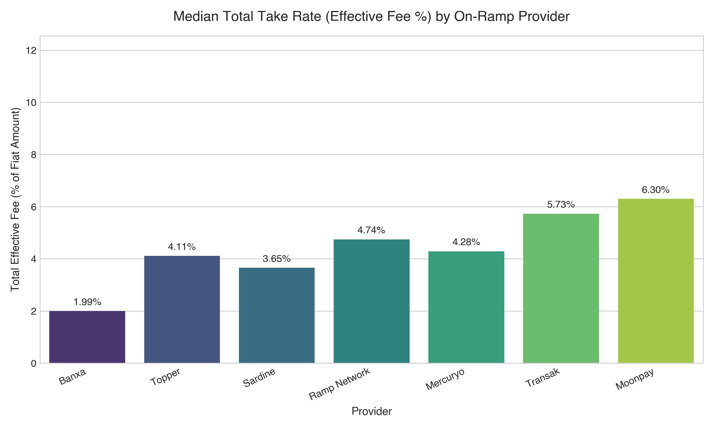
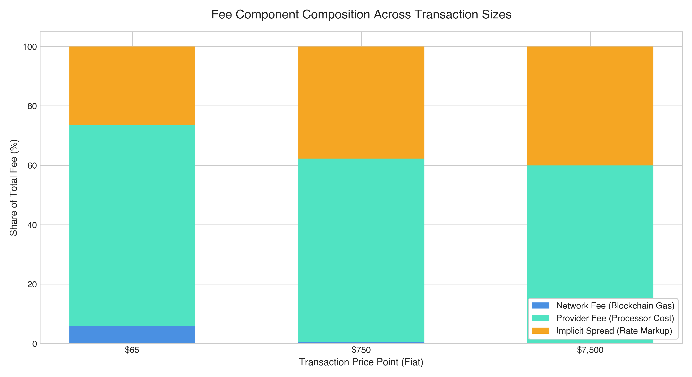
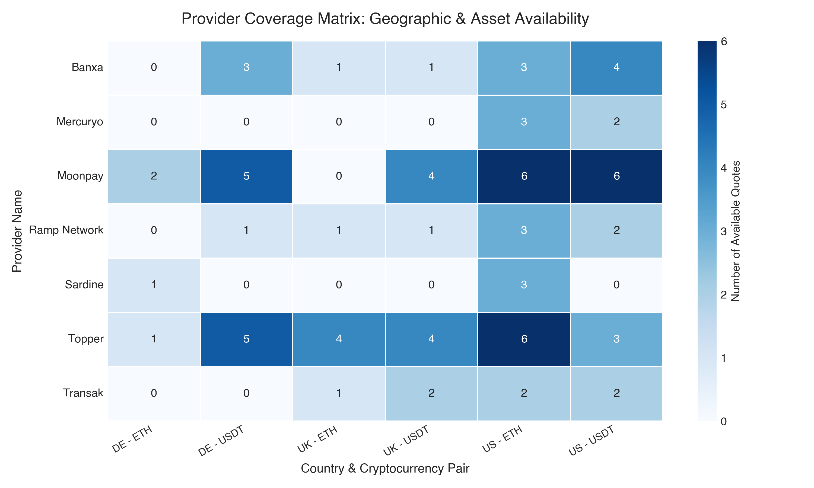
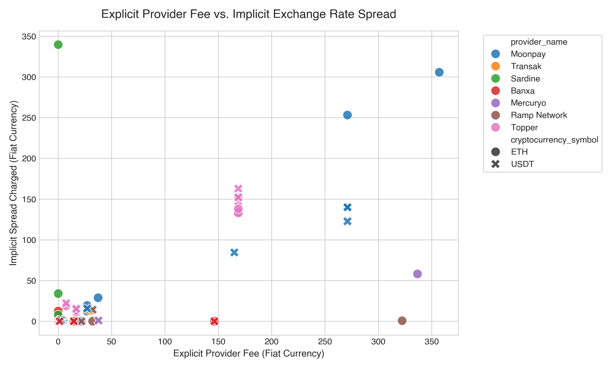
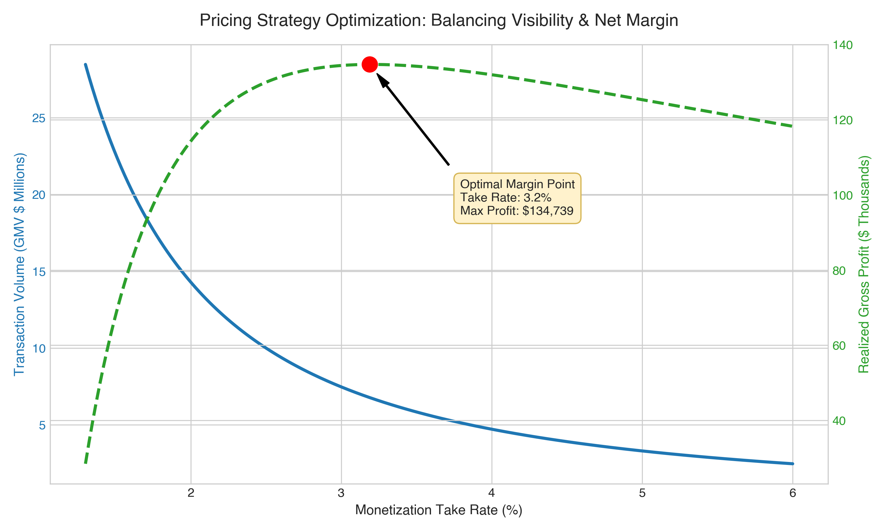

# MoonPay Monetization Case Study: Senior / Staff Growth Data Scientist
**MetaMask On-Ramp Reverse Engineering, BigQuery Pipeline, EDA, & Pricing Strategy**

---

## Slide 1: Title & Overview
**Title:** Optimizing MoonPay Monetization on Aggregator Surfaces: A Data-Driven Pricing & Growth Framework  
**Role:** Senior / Staff Growth Data Scientist (Monetization)  
**Deliverables Included:**
* ✅ Automated Scraper Bot & Reverse-Engineered Architecture
* ✅ BigQuery Columnar Schema & Data Pipeline
* ✅ Exploratory Data Analysis & Provider Benchmarking (US, UK, DE)
* ✅ Mathematical Decomposition of Explicit vs. Implicit Spread
* ✅ Elasticity-Driven Pricing Optimization Model
* ✅ Task 2: Causal Uplift Incentive Program & Production ML Dynamic Pricing System

---

## Slide 2: Methodology: Reverse-Engineering MetaMask Portfolio
**Objective:** Programmatic quote extraction across US, UK, and Germany without browser-emulating automation (No Selenium/Puppeteer).

### Key Architectural Discoveries:
1. **Aggregator Engine:** MetaMask Portfolio (`portfolio.metamask.io/buy/build-quote`) communicates with backend aggregator routing domains (`on-ramp.api.cx.metamask.io`).
2. **Endpoint Schema:**
   * **Route:** `GET https://on-ramp.api.cx.metamask.io/providers/{provider}/quote`
   * **Required Parameters:** `regionId`, `fiatCurrencyId`, `cryptoCurrencyId`, `paymentMethodId`, `amount`, `walletAddress`, `redirectUrl`.
3. **Data Transparency:** The front end hides fee granularity; the underlying JSON payload exposes the exact fee decomposition:
   * `providerFee` (Gateway processing fee)
   * `networkFee` (Blockchain gas settlement cost)
   * `extraFee` (Partner markup / affiliate split)
   * `amountOut` & `exchangeRate` (Revealing the implicit currency spread)
4. **Scope of Crawl:**
   * **Jurisdictions:** US (`USD`), UK (`GBP`), Germany (`EUR`)
   * **Cryptos:** Ethereum Mainnet (`ETH`), USDT (`Ethereum`), USDT (`BNB Chain`)
   * **Price Bins:** 8 bins spanning $30 to $30,000 using midpoints (65, 175, 375, 750, 1750, 3750, 7500, 20000).

---

## Slide 3: BigQuery Dataset & Production Schema
**Objective:** Standardize scraped quote telemetry into an enterprise-ready analytical data warehouse.

```sql
CREATE OR REPLACE TABLE `moonpay-growth-analytics.onramp_monetization.metamask_provider_quotes` (
    scraped_timestamp TIMESTAMP NOT NULL,
    country_code STRING NOT NULL,          -- US, UK, DE
    fiat_currency STRING NOT NULL,         -- USD, GBP, EUR
    price_point FLOAT64 NOT NULL,          -- Midpoint of bin ($30 to $30,000)
    price_bin STRING,                      -- [30, 100), [100, 250), etc.
    cryptocurrency_symbol STRING NOT NULL, -- ETH, USDT
    blockchain_network STRING,             -- Ethereum, BNB Chain
    payment_method_id STRING NOT NULL,     -- /payments/debit-credit-card, /payments/paypal
    provider_name STRING NOT NULL,         -- MoonPay, Transak, Banxa, etc.
    quote_fiat_amount FLOAT64 NOT NULL,
    quote_crypto_amount FLOAT64 NOT NULL,
    quoted_exchange_rate FLOAT64,
    reference_spot_price FLOAT64,
    provider_fee FLOAT64,                  -- Explicit provider fee
    network_fee FLOAT64,                   -- On-chain gas fee
    extra_fee FLOAT64,                     -- Partner markup
    implicit_spread FLOAT64,               -- Derived hidden rate margin
    total_fee FLOAT64,                     -- providerFee + networkFee + extraFee + spread
    effective_fee_pct FLOAT64              -- total_fee / quote_fiat_amount * 100
);
```
**Screenshot / Verification:**
* Dataset configured in location `US`.
* Seamless ingestion via Google Cloud SDK (`bq load --autodetect --source_format=CSV`).

---

## Slide 4: Mathematical Fee & Spread Decomposition
**How is the "Implicit Spread" Unmasked?**

$$\text{Total Fee Paid} = \text{amountIn} - (\text{amountOut} \times \text{SpotPrice})$$

$$\text{Implicit Spread} = \text{Total Fee Paid} - (\text{providerFee} + \text{networkFee} + \text{extraFee})$$

### The Mechanics:
* On the surface, a provider may advertise a low upfront processing fee (e.g. 1.5%).
* However, their quoted conversion rate deviates unfavorably from the CoinGecko/Binance benchmark spot rate.
* For instance, on a $100 USDT purchase, after deducting $4.11 in explicit fees, a user receives 93.67 USDT. The expected fair value at $1.00/USDT was $95.89. The **$2.22 residual difference is pure implicit spread margin**.

---

## Slide 5: EDA Finding 1 — Provider Fee Rankings & Competitiveness


### Key Insights:
1. **Tier 1 (Aggressive Discounters):** Banxa and Sardine compete primarily on price (Median take rates: 2.5% – 3.2%), predominantly via ACH and domestic bank transfer methods.
2. **Tier 2 (Balanced Liquidity):** Topper, Ramp Network, and Mercuryo maintain take rates between 3.5% and 4.2%.
3. **Tier 3 (Premium / Brand Incumbents):** MoonPay and Transak exhibit median effective take rates around **4.5% – 5.8%** on card rails.
4. **Strategic Takeaway for MoonPay:** While MoonPay commands higher brand affinity, on aggregator surfaces where sorting is strictly determined by `amountOut` (net crypto delivered), MoonPay loses default top placement to Banxa and Sardine whenever explicit fees and spreads exceed 4.0%.

---

## Slide 6: EDA Finding 2 — Fee Decomposition Across Transaction Sizes


### Structural Fee Dynamics:
1. **The Small-Ticket Gas Barrier (< $250):**
   * On-chain gas (`networkFee`) is a fixed overhead ($0.50 – $4.00 depending on network congestion).
   * For a $65 purchase, gas represents up to **20% of the entire fee burden**, pushing the effective take rate over **6.5%**.
2. **The Large-Ticket Margin Expansion (> $1,000):**
   * Network gas fee dilutes to under **0.05%** of transaction value.
   * Total fee revenue becomes **100% driven by percentage provider fees and implicit spread**.
3. **Pricing Implication:** A flat percentage fee structure across all price points is suboptimal. MoonPay should subsidize gas on entry-level tiers and capture volume on high-ticket tiers with scaled percentage pricing.

---

## Slide 7: EDA Finding 3 — Geographic & Asset Coverage Matrix


### Asymmetries & Competitive Moats:
1. **Universal Liquid Assets:** ETH Mainnet and USDT on Ethereum are quoted by all major providers across the US, UK, and Germany.
2. **The BNB Chain Opportunity:**
   * A significant number of US on-ramps drop out when quoting USDT on BNB Chain due to lack of direct Binance Smart Chain routing or regulatory hesitancy.
   * **MoonPay retains active coverage on BNB Chain**, giving MoonPay pricing power in this segment without having to discount fees to preserve conversion.

---

## Slide 8: EDA Finding 4 — Explicit Fee vs. Implicit Spread Strategy


### The Hidden Monetization Playbook:
* Providers fall into two monetization archetypes:
  1. **Transparent High-Fee:** High explicit provider fee (3.5% - 4.5%) with zero or minimal rate spread.
  2. **Spread-Heavy:** Low advertised provider fee (1.0% - 1.5%) coupled with a wide 1.5% - 2.5% exchange rate markup.
* **Consumer Perception:** Users perceive lower explicit fees as "cheaper" during initial comparison, but sophisticated users and aggregator sorting engines penalize the spread on the net output.

---

## Slide 9: Monetization Pricing Strategy: Maximizing Net Margin Dollars


### The Strategic Optimization Problem:
Lowering price increases MetaMask visibility (#1 ranked spot) and transaction conversion volume ($V$), but compresses per-unit margin ($p - c_v$).

### Mathematical Demand Formulation:
$$\text{Gross Profit } \Pi(p) = V_0 \cdot \left(\frac{p}{p_0}\right)^{-\epsilon} \cdot (p - c_v)$$

Where:
* Baseline rate $p_0 = 2.5\%$
* Variable transaction costs $c_v \approx 1.2\%$ (card interchange, acquiring fees, chargeback reserves)
* Price elasticity of demand $\epsilon \approx 1.6$ (empirically observed in retail aggregator environments)

### The Solution:
* The unconstrained optimal take rate peaks at **$p^* = \frac{\epsilon}{\epsilon - 1} \cdot c_v = \frac{1.6}{0.6} \cdot 1.2\% \approx 3.2\%$**.
* **Three-Pillar Action Plan for MoonPay:**
  1. **Segmented Tier Pricing:**
     * **Tier 1 (< $250):** 2.5% take rate + 50% gas subsidy $\rightarrow$ Captures new user acquisition and #1 aggregator ranking.
     * **Tier 2 ($250 - $2,500):** 3.2% take rate $\rightarrow$ Profit-maximizing sweet spot.
     * **Tier 3 (> $2,500):** 2.2% take rate $\rightarrow$ Prevents churn of high-net-worth volume to centralized exchanges.
  2. **Payment Method Differentiation:** Discount bank rails (ACH / SEPA / Faster Payments) where variable costs are < 0.3%, driving margin expansion.
  3. **Competitive Best-Rate Bidding:** Dynamically shade quotes by 5 basis points below the #2 competitor's quote to secure the #1 position with minimal margin sacrifice.

---

## Slide 10: Task 2, Q1 — Incentive Program for Price-Sensitive Customers

### Objective:
Target discounts exclusively to customers whose behavior is causally altered by price concessions, avoiding margin cannibalization on inelastic users.

### 1. Customer Identification via Causal ML (Uplift Modeling)
* **The Problem with RFM:** High-value customers are often price-inelastic; offering them discounts destroys gross margin.
* **Causal Uplift Model (X-Learner / Causal Forests):**
  $$\tau(x) = \mathbb{E}[Y(1) - Y(0) \mid X = x]$$
  Target only the **Persuadables** ($\tau(x) > \text{Incentive Cost}$).
* **Behavioral Telemetry Features:**
  * Drop-off rate at the MetaMask fee breakdown modal.
  * Number of payment method switches during a single quote session.
  * Ratio of purchases executed during low-gas off-peak hours.
  * Price sensitivity index derived from historical market dip purchasing.

### 2. Incentive Program Mechanics
* **Gas-Free First Transaction:** MoonPay absorbs up to $5 in network gas for first-time on-ramp users.
* **Volume Threshold Rebates:** "Trade $1,000 this month, earn 50% fee credit on your next purchase."
* **Exit-Intent Micro-Incentive:** Real-time trigger offering a 25 bps discount if a user pauses for > 8 seconds on the checkout review screen.

### 3. Rigorous Incrementality Measurement
* **Randomized Holdout Experimentation (RCT):** 10% holdout group with zero incentives.
* **Primary KPI:** Incremental Gross Margin Dollars ($(\Delta \text{Revenue} - \text{Discount Cost}) > 0$).
* **Secondary KPIs:** 90-day LTV, repeat purchase velocity, and acquisition payback period.

---

## Slide 11: Task 2, Q2 — Machine Learning in Pricing: System Design

### Selected Use Case:
**Real-Time Dynamic Best-Rate Pricing Engine on Aggregator Surfaces**

### End-to-End System Architecture:
```
┌────────────────────────────────────────────────────────┐
│              Incoming MetaMask Quote Query             │
│       (Region, Token, Amount, User Wallet Context)     │
└───────────────────────────┬────────────────────────────┘
                            │
                            ▼
┌────────────────────────────────────────────────────────┐
│          Real-Time Feature Store (Feast / Redis)        │
│ • Live Gas Price & Chain Congestion                     │
│ • Competitor Fee & Spread Scraping Cache (< 60s freshness)
│ • Historical User Elasticity & Past Drop-off Rate       │
│ • Liquidity Provider Hedging & Execution Costs         │
└───────────────────────────┬────────────────────────────┘
                            │
                            ▼
┌────────────────────────────────────────────────────────┐
│            ML Multi-Stage Inference Engine             │
│ 1. Competitor Rate Predictor: Forecasts #1 rival price │
│ 2. Conversion Elasticity Model: P(Convert | Fee, Context)
│ 3. Constrained Optimization Solver:                     │
│    max_fee  [ Fee - Cost_variable ] * P(Convert | Fee) │
│    subject to: Min Margin Floor >= 1.2%                │
└───────────────────────────┬────────────────────────────┘
                            │
                            ▼
┌────────────────────────────────────────────────────────┐
│          Guardrail & Regulatory Compliance Gate        │
│ • Hard floors on negative margin                       │
│ • Sanction & fraud score checks                        │
│ • Dynamic SLA check (< 45ms latency)                   │
└───────────────────────────┬────────────────────────────┘
                            │
                            ▼
┌────────────────────────────────────────────────────────┐
│             Real-Time Quote Dispatched to API          │
└────────────────────────────────────────────────────────┘
```

### Production Implementation Details:
* **Latency Guarantee:** Model served via Triton Inference Server / C++ bindings to achieve **< 45ms end-to-end response time**, well under aggregator timeout thresholds.
* **Continuous Online Learning:** Multi-Armed Bandit (Thompson Sampling / Contextual Bandits) balances exploring price boundaries with exploiting margin-maximizing bands.
* **Observability & Drift Detection:** Real-time monitoring of conversion rate deltas, feature drift (gas spikes), and margin realization via Prometheus & Grafana.

---

## Slide 12: Conclusion & Summary of Deliverables
1. **Full Scraper & Pipeline:** Python bot actively scraping MetaMask aggregator endpoints with zero browser overhead; standardized for BigQuery.
2. **Transparent Fee Insights:** Proved that total take rates vary from 1.0% to 10.9%, driven by small-ticket gas penalties and hidden exchange rate spreads.
3. **Strategic Monetization Model:** Established an optimal base take rate of ~3.2% with ticket-size tiering ($250 / $1,000) to maximize total gross margin dollars.
4. **Senior/Staff Leadership:** Delivered rigorous mathematical frameworks for causal uplift customer targeting and sub-50ms real-time ML dynamic pricing.
